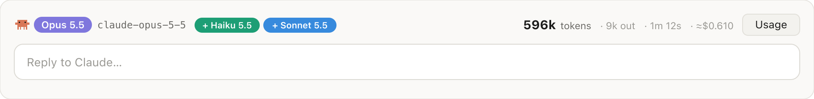
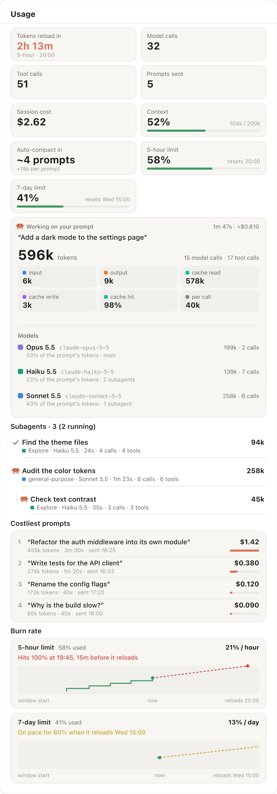

<div align="center">

# 📊 claude-usage

**See what every prompt costs you in Claude Code: tokens, models, subagents, the prompt cache and your rate limits, live.**

`usage-panel` is a Claude Code mod: a live **Usage** pane beside the conversation and a one-line band above the prompt input.

     

</div>

---

## 👀 Preview

**The band above the prompt input**, while a prompt runs:



**The Usage pane** beside the conversation:

<p align="center">

</p>

<sub>Screenshots of the desktop app, drawn from made-up demo data. A terminal gets the same figures as text.</sub>

## ⚡ Install

On each device, in any shell:

```bash
gh api repos/jamesnguyen1309/claude-usage/contents/install.sh -H "Accept: application/vnd.github.raw" | bash
```

Then start a new Claude Code session: the Usage pane opens on its own.

<details>
<summary>Other ways to install</summary>

**Two commands, no script:**

```bash
claude plugin marketplace add jamesnguyen1309/claude-usage
claude plugin install usage-panel@claude-usage --scope user
```

**From inside a terminal `claude` session:**

```
/plugin install usage-panel --marketplace jamesnguyen1309/claude-usage
```

Answer `y` to add the marketplace, then pick the **user** scope.

**Only for one project:** run the script with `SCOPE=project` (shared through the project's `.claude/settings.json`) or `SCOPE=local` (just you).

</details>

## ✨ What you get

### Above the prompt input

One line for the prompt in progress (or the last one):

| | |
| --- | --- |
| **Model** | the main model as a chip, with its full id (`claude-opus-5-5`), plus a chip for each other model its subagents used |
| **Tokens** | the prompt's total across the main conversation and every subagent, and how many were output |
| **Time · cost** | how long it has run, and what it cost |
| **Cache** | once the prompt is done, how long the prompt cache stays warm (*cache warm 3m 12s*), then *cache cold*: a prompt sent while it is warm reads the conversation at a tenth of the price |
| **Usage** | a button that shows or hides the pane |

### The Usage pane

| Section | Shows |
| --- | --- |
| **Statistics** | when your tokens next reload (a countdown to the soonest rate-limit reset, and which window), model and tool calls across the conversation, prompts sent, session cost, context window fill, how many prompts until auto-compact at your recent growth per prompt (*~6 prompts · +20k per prompt*), and the 5-hour and 7-day limits with when each resets. Meters turn amber at 70% and red at 90%. |
| **This prompt** | total tokens; input, output, cache reads and writes, the cache hit rate and tokens per call; each model that worked on it, with its id, calls, tokens, share of the prompt and whether it ran the main conversation or subagents |
| **Subagents** | each subagent the prompt started, nested under the one that started it: live status, model, time, calls, tools and tokens |
| **Costliest prompts** | the session's five most expensive finished prompts, costliest first: what you asked, its cost, tokens and time |
| **Burn rate** | for the 5-hour and 7-day limits, how fast each is being used (% per hour, % per day) and where that pace leads: *Hits 100% at 14:52, 1h 22m before it reloads* in red, or *On pace for 71% when it reloads*. A small chart shows the window so far, solid, and the pace carried on, dashed. |

### Warnings

| When | You see |
| --- | --- |
| A rate-limit window's pace means it runs out before it reloads | a toast, even with the pane closed: *5-hour limit: on pace to hit 100% at 14:52, 20m before it reloads*. Once per window, whichever session notices first. |
| A prompt had to write the whole conversation to the cache again | an amber line on its card saying why and what it cost: *Cache rewritten after 12m 04s idle (the cache lasts 5m): 180k tokens, ≈$0.40 of this prompt* |
| Only a couple of prompts are left before auto-compact | the forecast turns amber |

While Claude works, a little animated Claude (the orange pixel crab, stepping and waving) marks what is running: the prompt card, each subagent and the band. The desktop app draws cards, bars and chips; a terminal gets the same figures as text. `/usage-panel` shows or hides the pane.

## 🔄 Update · remove

```bash
# after a new version is pushed (the install script does this too)
claude plugin marketplace update claude-usage && claude plugin update usage-panel@claude-usage

# remove
claude plugin uninstall usage-panel@claude-usage
```

Start a new session afterwards for the change to load.

Installed before the GitHub account was renamed? `claude plugin marketplace update` will show it cloning from `jamesbrad1309/claude-usage`. That still works through GitHub's redirect, but to point it at the current name, add the marketplace again (this resets the mod's saved burn-rate readings and learned cache lifetime):

```bash
claude plugin marketplace remove claude-usage && claude plugin marketplace add jamesnguyen1309/claude-usage && claude plugin install usage-panel@claude-usage --scope user
```

## 📐 How the figures are counted

- **Tokens** come from each model call's usage as the API reports it, main conversation and subagents together. Cache reads usually dominate: each call re-reads the conversation from cache, at a fraction of the price of fresh input.
- **Cost** is Claude Code's own ledger, the one `/cost` totals. A prompt's cost is how much the session's total grew while it ran, subagents included; subagents show tokens, not dollars.
- **The cache's lifetime** isn't reported by Claude Code, so the mod learns it: 5 minutes to begin with, an hour once a prompt reads the cache after more than 5 idle minutes (and 5 again if one then finds it gone). It is kept across sessions.
- **A cache rewrite's cost** is its share of the prompt's cost, with each kind of token weighed by its price relative to fresh input (output 5×, cache read 0.1×, cache write 1.25× or 2× for the hour-long cache). Subagents on cheaper models make it a slight overestimate.
- **Prompts until auto-compact** compares the context with the point where it compacts, the window less the compaction buffer as `/context` shows them, at the average growth over your last few prompts.
- **Burn-rate readings** are kept across sessions, since the limits are your account's; readings older than 8 days are dropped.
- **Per session:** each session shows only its own prompts, and keeps its latest 50 (Costliest prompts picks from those). *Prompts sent* also counts the ones sent before the mod loaded, once the conversation has drawn them.
- **Nothing leaves your machine:** the mod reads Claude Code's own figures, and reads or writes no files.

## 🛠 Develop

```bash
claude plugin validate .   # manifest, marketplace and hooks module
claude plugin test .       # behaviour tests, terminal and desktop
claude --plugin-dir .      # run a session with this working copy
```

| File | Role |
| --- | --- |
| `hooks/register.tsx` | the hooks: bookkeeping, the pane, the band, the terminal views |
| `hooks/draw.ts` | the desktop drawings (SVG) |
| `hooks/burn.ts` | the burn rate and its forecast |
| `hooks/cache.ts` | the cache countdown and rewrites, the auto-compact forecast, the costliest prompts |
| `types/index.d.ts` | the state contract |
| `tests/usage-panel.test.ts` | behaviour tests |
| `install.sh` | installs or updates the mod on a device |
| `.claude-plugin/` | the mod's manifest and the marketplace that lists it |

To release: bump `version` in `.claude-plugin/plugin.json`, `.claude-plugin/marketplace.json` and the README's version badge, push, then update on each device. Installed copies only update when the version changes.
